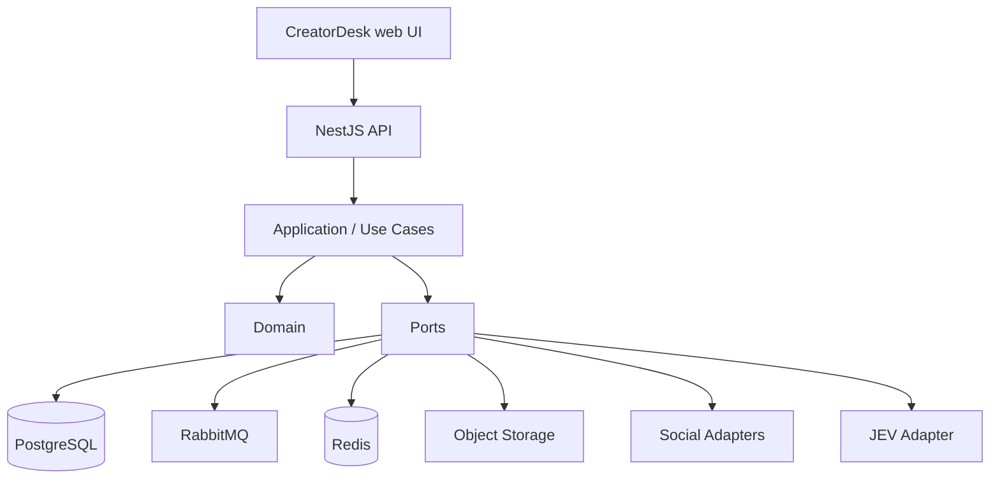

# Architecture

## 1. Architectural Style

Hexagonal Architecture with a Modular Monolith deployment model.

## 2. High-Level Architecture



The current pilot UI is static browser assets served by the NestJS application. The Next.js administration console remains a later-phase presentation adapter; it is not required for the Phase 1 Auth0 BFF.

## 3. Dependency Rule

The domain must not depend on:

- NestJS;
- ORM;
- PostgreSQL;
- RabbitMQ;
- Redis;
- object storage;
- social SDKs;
- JEV SDK.

## 4. Suggested Structure

```text
src/
├── domain/
│   ├── content/
│   ├── publication/
│   ├── social-account/
│   ├── metrics/
│   ├── comment/
│   ├── response/
│   └── intelligence/
│       ├── analysis/
│       ├── audience-insight/
│       └── recommendation/
│
├── application/
│   ├── content/
│   ├── publication/
│   ├── analytics/
│   ├── comments/
│   ├── responses/
│   └── intelligence/
│
├── infrastructure/
│   ├── persistence/
│   ├── messaging/
│   ├── storage/
│   ├── social/
│   └── intelligence/
│       └── jev/
│
└── presentation/
    └── http/
```

## 5. Intelligence Ports

The application should expose capability-oriented ports.

```typescript
interface CommentEvaluator {
  evaluate(input: CommentEvaluationInput): Promise<CommentAnalysis>;
}

interface ResponseEvaluator {
  evaluate(input: ResponseEvaluationInput): Promise<ResponseEvaluation>;
}

interface AudienceInsightGenerator {
  generate(input: AudienceInsightInput): Promise<AudienceInsightResult>;
}

interface ContentRecommendationGenerator {
  generate(input: ContentRecommendationInput): Promise<ContentRecommendationResult>;
}
```

JEV can implement these capabilities behind adapters.

## 6. Social Ports

```typescript
interface VideoPublisher {
  publish(request: PublishRequest): Promise<PublicationResult>;
}

interface MetricsReader {
  getMetrics(id: string): Promise<VideoMetrics>;
}

interface CommentReader {
  getComments(id: string): Promise<CommentPage>;
}

interface CommentResponder {
  reply(id: string, message: string): Promise<CommentReply>;
}
```

`MetricsReader` is a future provider-integration port for analytics. The initial Novelaria dashboard records performance manually and does not call this port.

## 7. Async Processing

Use RabbitMQ for:

- publication;
- future provider metric synchronization (not required by the manually fed Novelaria dashboard MVP);
- comment synchronization;
- comment evaluation;
- response evaluation;
- aggregate intelligence.

## 8. Core Flow

```text
Social API
    ↓
Comment Ingestion
    ↓
Normalized Comment
    ↓
CommentEvaluator
    ↓
JEV Adapter
    ↓
CommentAnalysis
    ↓
Response / Insight / Decision
```

## 9. Internationalization and Localization

The application-owned localization port, locale/timezone policies, JSON catalog adapter, and decisions are specified in [Internationalization and Localization Architecture](internationalization.md), [ADR-005](decisions/ADR-005-internationalization.md), and the [localization contract](../contracts/localization.md). The domain remains language-independent.

## 10. Infrastructure Adapter Foundations

- Relational persistence uses PostgreSQL through `pg`; the application-facing port supports parameterized queries and transactions. The HTTP composition root creates a configured pool, verifies connectivity during startup, and closes it during shutdown. Runtime migrations are not applied automatically; schema changes use the ordered SQL migration files. Physical schemas and repositories remain capability-specific; no ORM is selected.
- RabbitMQ uses `amqplib` behind a job-queue port. Messages are JSON-serialized, and each consumer explicitly chooses `requeue` or `reject` after handler failure. Retry limits, backoff, dead-lettering, and delivery guarantees remain open.
- S3-compatible media storage uses AWS SDK v3 behind the media-storage port. The returned reference contains an object key, not a signed URL or provider credentials.
- Connection strings, credentials, endpoints, and bucket configuration are supplied at the infrastructure/composition boundary and are not stored in domain objects or logged.
