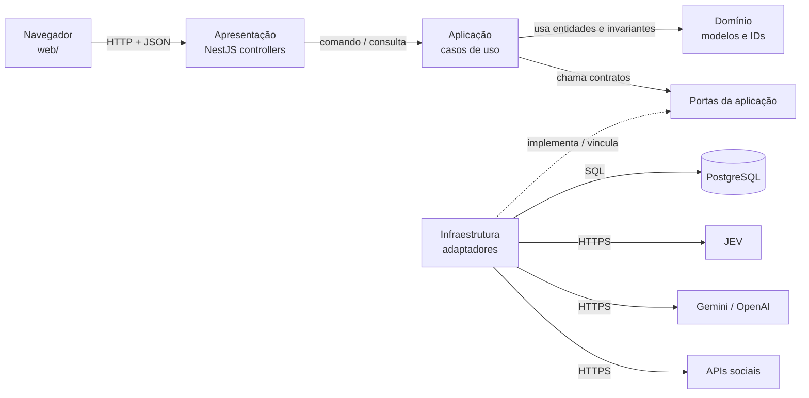
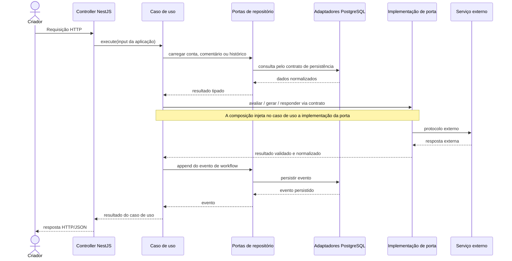

# Arquitetura hexagonal implementada

Este documento descreve a arquitetura que existe hoje no código, com foco no fluxo de comentários. Complementa a visão geral em [architecture.md](architecture.md) e a decisão [ADR-001](decisions/ADR-001-hexagonal-architecture.md).

## Visão geral

O projeto é um monólito modular. A API HTTP NestJS, os casos de uso, o domínio e os adaptadores são executados no mesmo processo; as integrações externas são chamadas por adaptadores de infraestrutura.

As setas sólidas representam chamadas ou dados em tempo de execução. A seta tracejada representa a dependência de implementação: a infraestrutura implementa contratos definidos pela aplicação. A aplicação não importa os clientes concretos de JEV, dos provedores de texto ou das redes sociais.

## Responsabilidade de cada parte

| Parte | Código atual | Responsabilidade |
| --- | --- | --- |
| Apresentação | `src/presentation/http/` | Receber HTTP, validar parâmetros e corpo da requisição, chamar o caso de uso e converter erros conhecidos em respostas HTTP. |
| Aplicação | `src/application/social/` | Orquestrar os casos de uso: resolver o tenant, carregar conta/comentário, aplicar pré-condições, chamar portas e registrar os resultados do workflow. |
| Portas | `src/application/ports/` | Definir os contratos que os casos de uso precisam, como repositórios, avaliação JEV, geração de resposta e resposta social. |
| Domínio | `src/domain/` | Conter modelos e invariantes independentes de NestJS, PostgreSQL e provedores externos. Hoje há modelos de `Content`, `SocialAccount` e seus IDs; o fluxo de comentários ainda não tem agregados próprios de domínio. |
| Infraestrutura | `src/infrastructure/` | Implementar portas: persistência PostgreSQL, adaptadores independentes por rede social, JEV, Gemini, OpenAI e outros serviços externos. |

No fluxo de comentários, a análise, as sugestões, as revisões e as avaliações são representadas principalmente como resultados tipados da aplicação e eventos append-only do workflow. As regras de orquestração desse fluxo ficam nos casos de uso; elas não estão encapsuladas em um agregado `Comment` ou `Response` em `src/domain/`.

## Como as camadas se comunicam

1. O navegador envia uma requisição para um controller NestJS. Por exemplo, `CommentIntelligenceController` recebe a classificação ou a geração de sugestão.
2. O controller valida o formato HTTP e chama diretamente uma classe de caso de uso, passando um input da aplicação. Não há uma interface inbound separada para cada caso de uso neste recorte.
3. O caso de uso resolve o tenant e usa portas de repositório para carregar conta, comentário e histórico. Para IDs com invariantes, usa tipos/funções do domínio, como `parseSocialAccountId`.
4. Quando precisa de uma integração, o caso de uso chama uma porta da aplicação. Em tempo de execução, a composição NestJS fornece uma implementação de infraestrutura para essa porta.
5. O adaptador traduz os tipos internos para o protocolo externo (HTTP/JSON ou SQL), executa a chamada e converte a resposta de volta para os tipos esperados pela aplicação.
6. O caso de uso valida pré-condições e resultado, grava o evento através do repositório de workflow e devolve o resultado ao controller. O controller produz a resposta HTTP.

## Portas e adaptadores no fluxo de comentários

| Necessidade da aplicação | Porta | Implementação atual |
| --- | --- | --- |
| Ler/gravar comentários normalizados | `SocialCommentRepository` | `PostgresSocialCommentRepository` |
| Registrar histórico de classificação, sugestão, avaliação e envio | `CommentWorkflowEventRepository` | `PostgresCommentWorkflowEventRepository` |
| Classificar um comentário | `CommentEvaluator` | `JevCommentEvaluator` |
| Avaliar uma resposta salva | `ResponseEvaluator` | `JevResponseEvaluator` |
| Gerar uma sugestão de resposta | `ResponseSuggestionGenerator` | `ConfiguredResponseSuggestionGenerator`, que seleciona Gemini ou OpenAI |
| Enviar uma resposta manual | `SocialCommentResponder` | `PlatformSocialCommentResponder`, que delega ao adaptador da plataforma |

Os DTOs de protocolo externo permanecem dentro dos adaptadores. Por exemplo, os formatos JSON de JEV e dos provedores de texto não são tipos de entrada dos controllers nem contratos do domínio. Os adaptadores validam a resposta externa e devolvem resultados com os campos previstos pelas portas.

## Composição e injeção de dependências

`src/presentation/http/main.ts` cria a aplicação NestJS com `AppModule.withPostgres(...)`. O `AppModule` é o ponto de composição: registra controllers e importa `PostgresPersistenceModule.register(...)`. Esse módulo registra repositórios e associa portas a adaptadores concretos por tokens/factories do NestJS.

Por exemplo, `COMMENT_EVALUATOR` é vinculado a `JevCommentEvaluator`, `RESPONSE_EVALUATOR` a `JevResponseEvaluator` e `RESPONSE_SUGGESTION_GENERATOR` a `ConfiguredResponseSuggestionGenerator`. Este último recebe os adaptadores de Gemini e OpenAI e seleciona o ativo conforme a configuração persistida. Os casos de uso recebem esses contratos por seus construtores; os testes podem fornecer substitutos determinísticos sem chamar os serviços reais.

## Limites atuais

- O fluxo de comentários de ponta a ponta é síncrono na requisição HTTP: o caso de uso chama o adaptador e aguarda a resposta. Embora exista uma porta/adaptador de fila para outros usos ou evolução, classificação, geração, avaliação e envio de comentário não passam atualmente pelo RabbitMQ.
- JEV recebe apenas o contexto preparado pela aplicação e não consulta banco de dados nem APIs sociais.
- Cada plataforma social tem adaptador próprio; normalização e capacidades não são presumidas como iguais entre plataformas.
- `docs/architecture/architecture.md` também registra componentes de arquitetura mais amplos. Este documento diferencia essa visão geral do recorte efetivamente conectado no fluxo de comentários.

## Código de referência

- Composition root e controllers: [AppModule](../../src/presentation/http/app.module.ts), [CommentIntelligenceController](../../src/presentation/http/comment-intelligence.controller.ts).
- Orquestração: [casos de uso de inteligência](../../src/application/social/comment-intelligence.usecases.ts), [workflow de auditoria](../../src/application/social/comment-workflow-audit.ts).
- Contratos: [CommentEvaluator](../../src/application/ports/comment-evaluator.port.ts), [ResponseEvaluator](../../src/application/ports/response-evaluator.port.ts), [ResponseSuggestionGenerator](../../src/application/ports/response-suggestion-generator.port.ts).
- Adaptadores e bindings: [PostgresPersistenceModule](../../src/infrastructure/persistence/postgres-persistence.module.ts), [adaptador JEV de comentário](../../src/infrastructure/intelligence/jev-comment-evaluator.ts), [adaptador JEV de resposta](../../src/infrastructure/intelligence/jev-response-evaluator.ts).
- Detalhes dos payloads e do fluxo: [resposta e avaliação de comentários](fluxo-resposta-e-avaliacao-de-comentarios.md).
