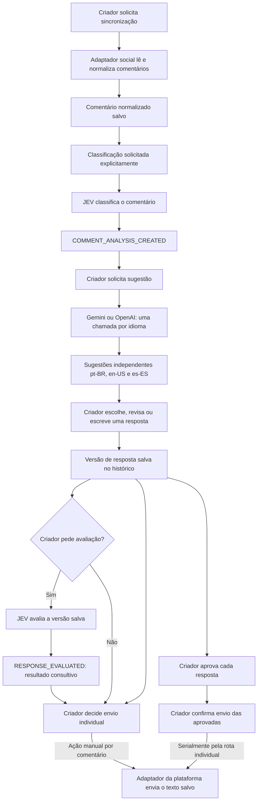
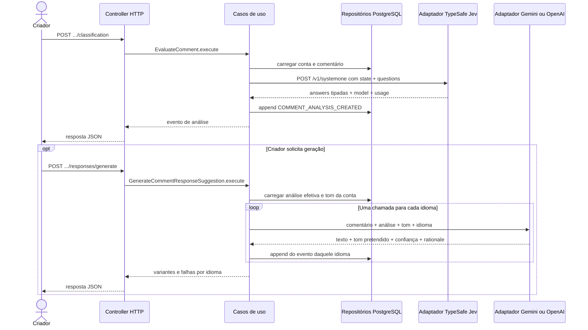
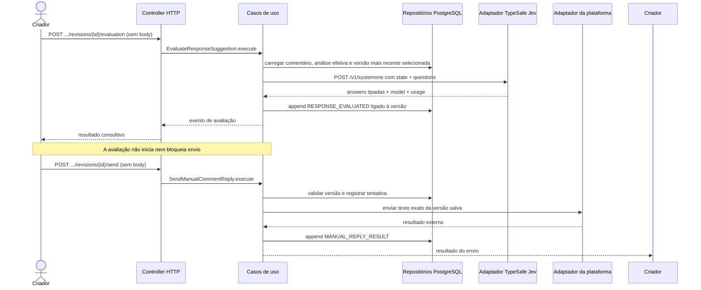

# Fluxo de resposta e avaliação de comentários

Este documento descreve o fluxo implementado com TypeSafe Jev. O Jev avalia perguntas tipadas; não recebe um system prompt e não gera texto. Para a separação das camadas, veja [arquitetura hexagonal implementada](arquitetura-hexagonal-implementada.md) e o [contrato da integração](../integrations/jev.md).

O endpoint e os tipos da API estão documentados pela TypeSafe. O uso de créditos reais é separado dos testes automatizados, que usam respostas simuladas determinísticas.

## Quem faz o quê

| Componente | Papel neste fluxo |
| --- | --- |
| JEV | Classifica o comentário e, em uma ação separada, avalia uma resposta já salva. Não gera o texto da resposta e não chama APIs sociais. |
| Gemini ou OpenAI | Gera sugestões de texto quando o criador pede. A configuração ativa escolhe um provedor e um modelo. |
| Adaptador da plataforma social | Sincroniza comentários e envia a resposta exata somente após uma ação manual do criador. |
| Aplicação e PostgreSQL | Validam pré-condições, mantêm versões separadas e registram os resultados no histórico do workflow. |

## Visão ponta a ponta



Classificação, geração, avaliação e envio são ações distintas. Classificação e geração podem ser executadas individualmente ou dentro de um batch. No diálogo semi-automático, a aprovação não envia; uma confirmação separada envia somente as versões salvas e aprovadas, uma por vez, usando a rota individual. Falhas comuns ficam associadas a cada comentário sem cancelar as próximas; uma resposta de limite da plataforma interrompe a fila.

## 1. Sincronizar e classificar o comentário

### Sincronização

`POST /social/accounts/{accountId}/publications/{publicationId}/comments/sync` chama `SyncPublicationComments`. O caso de uso escolhe o leitor de acordo com a plataforma, valida e normaliza os dados recebidos e salva a página de comentários. Entre os campos normalizados estão plataforma, IDs externos do comentário/thread/publicação, texto, autor, data e capacidade de responder. A sincronização é sob demanda. O ID externo do comentário continua sendo usado para localizar o comentário; ele não é incluído nos payloads de avaliação JEV descritos abaixo.

### Avaliação/classificação por JEV

`POST /social/accounts/{accountId}/comments/{externalCommentId}/classification` carrega a conta e o comentário persistido no tenant atual e chama `CommentEvaluator`. O adaptador transforma os dados em `state` e perguntas tipadas para `POST https://api.typesafe.ai/v1/systemone`:

```json
{
  "model": "jev-latest",
  "state": {
    "comment": { "text": "Texto original do comentário" },
    "publication": { "platform": "youtube", "externalPublicationId": "id-da-publicacao" }
  },
  "questions": {
    "sentiment": {
      "type": "choice",
      "instructions": "What sentiment does the comment express?",
      "criteria": {
        "POSITIVE": "Positive approval or appreciation.",
        "NEUTRAL": "No clear positive or negative sentiment.",
        "NEGATIVE": "Dissatisfaction or criticism."
      }
    },
    "intent": {
      "type": "choice",
      "instructions": "What is the primary intent of the comment?",
      "criteria": {
        "QUESTION": "Asks for information.",
        "PRAISE": "Compliments the creator or content.",
        "COMPLAINT": "Reports dissatisfaction or a problem.",
        "SUGGESTION": "Proposes an idea or change.",
        "CONTENT_REQUEST": "Explicitly asks for another part, episode, or more content.",
        "REACTION": "Shares a reaction without another primary intent.",
        "OTHER": "Does not fit another option."
      }
    },
    "spam": { "type": "noul", "instructions": "Is the comment primarily spam?" },
    "engagement": {
      "type": "score",
      "instructions": "Estimate engagement potential, including requests for more content. Do not penalize a short, explicit request.",
      "criteria": ["No clear interest", "Simple reaction", "Specific interest", "Explicit continuation/content demand", "Strong detailed discussion demand"]
    },
    "requests_continuation": {
      "type": "noul",
      "instructions": "Does the comment explicitly ask for another part, episode, or continuation?"
    }
  }
}
```

O `state` não inclui nome do autor, ID externo do comentário ou contagens observadas de likes/respostas. A requisição usa `Authorization: Bearer <chave>`; a chave não faz parte do corpo.

O Jev retorna `model`, respostas nomeadas em `answers` e `usage`. Cada resposta tem a forma correspondente ao seu tipo:

```json
{
  "model": "jev-1.14.0",
  "answers": {
    "sentiment": {
      "type": "choice",
      "choice": "POSITIVE",
      "confidence": 0.93,
      "probabilities": { "POSITIVE": 0.93, "NEUTRAL": 0.05, "NEGATIVE": 0.02 }
    },
    "spam": { "type": "noul", "noul": 0.01 },
    "engagement": {
      "type": "score",
      "score": 3.2,
      "confidence": 0.88,
      "legend": { "0": "No clear interest", "1": "Simple reaction", "2": "Specific interest", "3": "Explicit continuation/content demand", "4": "Strong detailed discussion demand" },
      "probabilities": { "0": 0.02, "1": 0.04, "2": 0.12, "3": 0.52, "4": 0.30 }
    },
    "requests_continuation": { "type": "noul", "noul": 0.98 }
  },
  "usage": { "input_tokens": 128, "output_tokens": 39 }
}
```

O adaptador executa nove perguntas independentes: sentimento, emoção, intenção, tópico, spam, toxicidade, potencial de engajamento, necessidade de fatos externos e pedido explícito de continuação. Um comentário curto como “Continuação parte 2” deve receber `CONTENT_REQUEST`, alta probabilidade em `requests_continuation` e pontuação de engajamento elevada; a probabilidade também é guardada como `continuationRequestProbability`. Escolhas guardam opção, probabilidades e confiança; o Score de engajamento é normalizado de `[0,4]` para `[0,1]`; Noul já retorna probabilidade `[0,1]`. O `confidence` agregado é o menor confidence entre respostas Choice/Score. `entity` e `rationale` ficam `null`, pois System One não gera texto livre. `model`, todas as evidências e contagem de tokens são preservados no evento `COMMENT_ANALYSIS_CREATED`; falhas não substituem análises anteriores.

### Correções humanas

O criador pode acrescentar correções auditadas para `sentiment`, `emotion`, `intent`, `topic`, `entity`, `spamScore`, `toxicityScore` ou `engagementValue`. A correção não altera o evento original, `confidence` ou `rationale`. Na geração e na avaliação da resposta, a aplicação monta a análise efetiva combinando o evento original com as correções associadas a ele.

## 2. Gerar uma sugestão por idioma

`POST /social/accounts/{accountId}/comments/{externalCommentId}/responses/generate` é uma ação explícita do criador e exige análise persistida. Sem `analysisEventId`, o caso de uso usa a análise mais recente; havendo correções, envia a versão efetiva. O corpo pode selecionar uma análise ou aplicar um tom primário apenas a esta geração, por exemplo `{"analysisEventId":"<event-id>","toneOverride":"PROFESSIONAL"}`; o campo `language` não é aceito. O cliente não seleciona o idioma: cada pedido gera `pt-BR`, `en-US` e `es-ES`. Usa-se o perfil de tom salvo na conta ou, se ausente, `FRIENDLY` sem modificadores/nota; `toneOverride` altera somente o tom primário desta execução. Para cada idioma, `ConfiguredResponseSuggestionGenerator` consulta o provedor/modelo ativo e chama o adaptador correspondente em sequência. A configuração atual permite Google `gemini-3.5-flash-lite` ou OpenAI `gpt-6-luna`.

### O que vai para o modelo de texto

Os dois adaptadores de texto enviam a mesma instrução de sistema. Ela orienta o LLM a usar os sinais como contexto de apoio; o texto original continua sendo a fonte primária:

```text
Create one helpful suggested reply to a social media comment. Treat the top-level comment-analysis values as effective guidance; they may include creator corrections. Treat TypeSafe signal probabilities as original model uncertainty evidence, not certainty. An explicit continuation request signals audience interest; acknowledge it without promising another part unless the supplied context confirms it. The engagement value is an estimate, not observed likes or replies; do not use it for engagement bait. Use only supplied context; when the signals indicate missing facts, avoid specific claims or ask a clarifying question. Never invent facts, promise actions, or claim access to information not provided. Follow the creator tone profile as a style preference without overriding accuracy or respect. Respond in exactly the requested language. Return a suggestion only; do not send or publish it.
```

O conteúdo de usuário é um JSON serializado com estes campos:

```json
{
  "requestedLanguage": "pt-BR",
  "responseToneProfile": {
    "primaryTone": "FRIENDLY",
    "modifiers": ["WARM"],
    "customNote": null
  },
  "platform": "youtube",
  "commentText": "Texto original do comentário",
  "commentAnalysis": {
    "sentiment": "POSITIVE",
    "emotion": "JOY",
    "intent": "REACTION",
    "topic": "CONTENT",
    "entity": null,
    "spamScore": 0.01,
    "toxicityScore": 0.01,
    "engagementValue": 0.8,
    "continuationRequestProbability": 0.02,
    "confidence": 0.82,
    "rationale": null,
    "signals": {
      "sentiment": { "confidence": 0.93, "probabilities": { "POSITIVE": 0.93, "NEUTRAL": 0.05, "NEGATIVE": 0.02 } },
      "emotion": { "confidence": 0.84, "probabilities": { "JOY": 0.84, "OTHER": 0.16 } },
      "intent": { "confidence": 0.87, "probabilities": { "REACTION": 0.87, "OTHER": 0.13 } },
      "topic": { "confidence": 0.82, "probabilities": { "CHARACTER": 0.82, "OTHER": 0.18 } },
      "spam": { "probability": 0.01 },
      "toxicity": { "probability": 0.01 },
      "engagement": {
        "rawScore": 3.2,
        "normalizedScore": 0.8,
        "confidence": 0.88,
        "probabilities": { "0": 0.02, "1": 0.04, "2": 0.12, "3": 0.52, "4": 0.30 },
        "legend": { "0": "Generic", "1": "Simple reaction", "2": "Specific opinion", "3": "Substantive discussion", "4": "Conversation starter" }
      },
      "needsExternalFacts": { "probability": 0.76 },
      "requestsContinuation": { "probability": 0.02 }
    }
  }
}
```

Os valores de sentimento/emoção/intenção/tópico no topo são efetivos e podem incluir correções humanas; `signals` preserva as probabilidades e confiança da classificação original. O adaptador não envia `provider`, `model`, `schemaVersion` nem `usage` ao LLM. O corpo também não envia ID da conta, IDs externos, nome do autor, texto/metadados da publicação ou política de comunicação separada. Contexto de publicação só será enviado se a aplicação passar esses dados explicitamente.

### Diferenças de transporte entre provedores

| Provedor | Transporte e validação |
| --- | --- |
| Gemini | `POST https://generativelanguage.googleapis.com/v1beta/models/{model}:generateContent`; chave em `x-goog-api-key`; resposta configurada como JSON com schema e limite de 256 tokens. Respostas bloqueadas por safety/recitation são rejeitadas. |
| OpenAI | `POST https://api.openai.com/v1/responses`; chave em `Authorization`; `store: false`, `reasoning.effort: "none"`, limite de 256 tokens e formato JSON Schema estrito. Respostas incompletas ou refusal são rejeitadas. |

O modelo deve retornar um objeto JSON equivalente a:

```json
{
  "text": "Sugestão de resposta no idioma solicitado.",
  "intendedTone": "FRIENDLY",
  "confidence": 0.91,
  "rationale": "A resposta reconhece a reação sem acrescentar fatos."
}
```

`text` e `intendedTone` devem ser strings não vazias; `confidence` deve estar em `[0,1]`; `rationale` deve ser uma string (uma string vazia vira `null`). O adaptador associa o idioma solicitado e a identificação do provedor/modelo ao resultado. Cada sucesso gera um evento independente `RESPONSE_SUGGESTION_GENERATED`, com a análise de origem e um snapshot do tom. Uma falha é registrada por idioma; sucessos parciais são preservados.

## 3. Salvar, revisar e avaliar uma resposta

Uma sugestão gerada é apenas texto sugerido. O criador pode editá-la em `POST .../suggestions/{suggestionEventId}/revisions` ou escrever uma resposta manual em `POST .../responses/manual`; edições manuais usam `POST .../responses/manual/{responseEventId}/revisions`. Cada edição cria um novo evento de versão; o texto anterior não é substituído. Respostas manuais podem ser criadas sem análise de comentário. Como cada idioma é uma variante independente, a avaliação TypeSafe/Jev é opcional e disparada manualmente para a versão salva mais recente da variante selecionada:

`POST /social/accounts/{accountId}/comments/{externalCommentId}/revisions/{revisionEventId}/evaluation`

A requisição da aplicação não tem corpo. A aplicação valida que a versão indicada é a mais recente de sua linhagem selecionada, carrega o comentário e exige uma análise persistida. Uma nova variante em outro idioma não invalida a versão; uma nova geração no mesmo idioma ou uma revisão posterior invalida versões anteriores dessa linhagem. O adapter envia o estado e as perguntas abaixo ao mesmo endpoint `POST https://api.typesafe.ai/v1/systemone` usado para classificação:

```json
{
  "model": "jev-latest",
  "state": {
    "comment": { "text": "Texto original do comentário" },
    "commentAnalysis": {
      "sentiment": "POSITIVE",
      "emotion": "JOY",
      "intent": "REACTION",
      "topic": "CONTENT",
      "spamScore": 0.01,
      "toxicityScore": 0.01,
      "engagementValue": 0.8,
      "signals": {
        "sentiment": { "confidence": 0.93, "probabilities": { "POSITIVE": 0.93, "NEUTRAL": 0.05, "NEGATIVE": 0.02 } },
        "needsExternalFacts": { "probability": 0.76 }
      }
    },
    "response": { "text": "Texto exato da versão salva selecionada" }
  },
  "questions": {
    "relevance": { "type": "score", "instructions": "How directly does the response address the comment?", "criteria": ["Very poor", "Poor", "Adequate", "Good", "Excellent"] },
    "factual_risk": { "type": "noul", "instructions": "Does the response assert unsupported facts?" },
    "publish_recommendation": {
      "type": "choice",
      "instructions": "Choose an advisory recommendation based on the supplied state.",
      "criteria": {
        "APPROVE": "Relevant, respectful, helpful, and without material unsupported claims.",
        "REVIEW": "Ambiguous or needs creator review.",
        "REJECT": "Materially irrelevant, harmful, or seriously unsupported."
      }
    }
  }
}
```

O estado usa o texto exato da versão salva e a análise efetiva, inclusive correções; as evidências TypeSafe originais também podem ser incluídas sem sobrescrever os valores corrigidos. As perguntas são independentes: `publish_recommendation` precisa julgar o estado diretamente, sem depender das respostas das outras perguntas. O adaptador também envia perguntas para `tone`, `helpfulness`, `toxicity_risk` e `hallucination_risk`. A resposta bruta é aninhada em `answers`:

```json
{
  "model": "jev-1.14.0",
  "answers": {
    "relevance": {
      "type": "score",
      "score": 3.8,
      "confidence": 0.93,
      "legend": { "0": "Very poor", "1": "Poor", "2": "Adequate", "3": "Good", "4": "Excellent" },
      "probabilities": { "0": 0.01, "1": 0.02, "2": 0.07, "3": 0.30, "4": 0.60 }
    },
    "factual_risk": { "type": "noul", "noul": 0.02 },
    "publish_recommendation": {
      "type": "choice",
      "choice": "APPROVE",
      "confidence": 0.91,
      "probabilities": { "APPROVE": 0.91, "REVIEW": 0.08, "REJECT": 0.01 }
    }
  },
  "usage": { "input_tokens": 160, "output_tokens": 48 }
}
```

Scores TypeSafe são normalizados de `[0,4]` para `[0,1]`; probabilidades Noul já estão em `[0,1]`. O confidence agregado é o menor confidence entre Score/Choice answers e os valores individuais são preservados. O provider é `JEV`, o model vem da resposta TypeSafe, a versão do schema é interna e o uso de tokens é persistido. `rationale` é `null`. Uma resposta válida é gravada como `RESPONSE_EVALUATED`, vinculada à versão; uma versão superada dentro da linhagem selecionada não pode ser avaliada. Resposta inválida/falha externa gera evento `FAILED` sem substituir avaliações ou análises anteriores.

## 4. Envio: decisão separada e manual

`POST /social/accounts/{accountId}/comments/{externalCommentId}/revisions/{revisionEventId}/send` também não tem corpo: o cliente não envia texto. A aplicação usa exatamente o texto salvo na versão mais recente da linhagem selecionada e só chama `SocialCommentResponder` após validar conta, comentário, versão e capacidade `canReply`. Variantes de outros idiomas não tornam essa versão obsoleta. Se o criador alterou o texto no editor, a interface salva primeiro uma nova revisão e envia essa versão; o envio ainda depende da ação manual por comentário. Antes da chamada externa, é registrado `MANUAL_REPLY_ATTEMPTED`; o resultado é associado ao evento como `MANUAL_REPLY_RESULT`. Uma tentativa existente impede repetição para a mesma versão, resultado ambíguo não é reenviado automaticamente e o batch de workflow não envia respostas.

`APPROVE`, `REVIEW` e `REJECT` são informações consultivas: não iniciam nem bloqueiam o envio. O envio manual não exige avaliação de resposta nem análise de comentário. No recorte atual, o controle determinístico de envio verifica a versão salva e a capacidade da plataforma; não há um schema de política de comunicação do criador nem thresholds numéricos de risco configurados.

## Configuração, validação e limites

- A URL usada é fixa: `https://api.typesafe.ai/v1/systemone`. Preferências não configura endpoints separados nem header/prefixo.
- A chave TypeSafe é enviada em `Authorization: Bearer <chave>`. O adaptador procura a chave salva; em ambiente, `TYPESAFE_API_KEY` é preferida e `JEV_API_KEY` permanece como fallback legado.
- O modelo da requisição é `jev-latest`. A resposta real informa o ID servido, por exemplo `jev-1.14.0`; o app registra esse ID e usa `typesafe-systemone-v1` como versão interna do schema.
- `usage` (tokens de entrada/saída) e evidências por pergunta são mantidos no histórico para auditoria/estatística, mas o uso de tokens não é enviado ao LLM de texto.
- Scores e probabilidades inválidos, respostas JSON malformadas, answers ausentes ou opções fora da taxonomia são rejeitados com erros estáveis.
- A documentação TypeSafe define o contrato; uma chamada ao serviço real consome créditos. Testes automatizados usam mocks e não fazem chamadas externas.
- Os eventos do workflow são associados à retenção do comentário; no fluxo atual, comentários e eventos vinculados expiram após 30 dias.

## Diagramas de sequência

### Classificação e geração



### Avaliação e envio



## Código e especificações relacionados

- Casos de uso: [classificação, geração e avaliação](../../src/application/social/comment-intelligence.usecases.ts), [envio manual](../../src/application/social/send-manual-comment-reply.ts).
- Portas: [avaliação de comentário](../../src/application/ports/comment-evaluator.port.ts), [avaliação de resposta](../../src/application/ports/response-evaluator.port.ts), [geração de sugestão](../../src/application/ports/response-suggestion-generator.port.ts).
- Adaptadores: [JEV para comentário](../../src/infrastructure/intelligence/jev-comment-evaluator.ts), [JEV para resposta](../../src/infrastructure/intelligence/jev-response-evaluator.ts), [Gemini](../../src/infrastructure/intelligence/gemini-flash-lite-response-suggestion-generator.ts), [OpenAI](../../src/infrastructure/intelligence/openai-gpt-6-luna-response-suggestion-generator.ts).
- Persistência e rotas: [auditoria do workflow](../../src/application/social/comment-workflow-audit.ts), [controller de inteligência](../../src/presentation/http/comment-intelligence.controller.ts), [controller de auditoria](../../src/presentation/http/comment-workflow-audit.controller.ts).
- Especificações: [avaliar comentário](../specifications/comments/evaluate-comment.md), [gerar sugestão](../specifications/comments/generate-response.md), [avaliar resposta](../specifications/comments/evaluate-response.md), [integração JEV](../integrations/jev.md).
