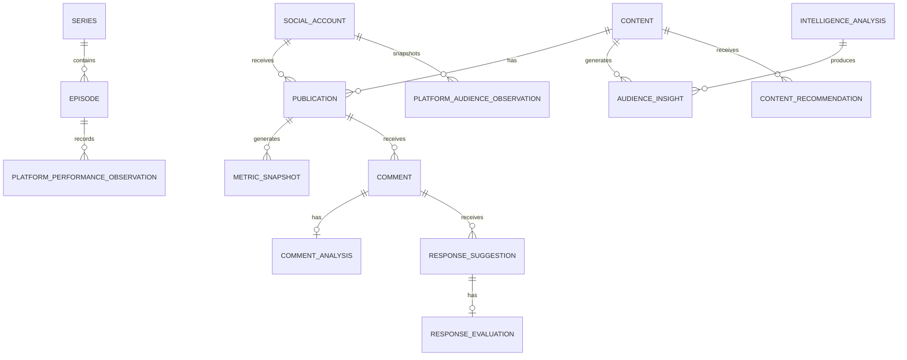

# Domain Model

## 1. Core Entities

### Content

Logical video asset owned by exactly one tenant, with required editorial title and description, a stored media reference, and manually managed Draft/Ready state. Its tenant ID is derived from authenticated server context. Destination-specific title, description, and tags belong to each Publication.

### Publication

A platform-specific publication of a Content.

`Content → Publication[]`

### SocialAccount

An authorized social account.

### Series

A tenant-owned Novelaria series used to group episodes for analytics and ranking.

### Episode

A tenant-owned analytics record with a stable human-readable code (for example `FQA-E07`), series identity, and episode number. The code is distinct from Content, Publication, and provider IDs. Episode production cost and production time are recorded once at episode level. The record can exist without a `Content` item or social publication; any future Content association must be explicit rather than inferred from titles or codes.

### PlatformPerformanceObservation

A manually entered, timestamped performance record for one Episode and platform in the Novelaria dashboard MVP. It preserves platform/source semantics and distinguishes unavailable metrics from measured zero. Current dashboard platforms are TikTok, Instagram, and Facebook; YouTube and API-imported values are future work.

### PlatformAudienceObservation

A dated snapshot of total followers for one tenant-owned platform account. Period net-new followers are calculated from valid snapshot deltas and are distinct from episode-attributed follower gains.

### MonthlyPlatformRevenue

A tenant-scoped structured BRL revenue amount for a platform and calendar month. It is separate from episode-level production costs.

### MetricSnapshot

A historical performance snapshot associated with a Publication, including provider-derived observations where available. Provider synchronization is future work for the manually fed Novelaria dashboard MVP.

### Comment

Audience interaction associated with a Publication. Preserve provider reply capability and provider-supported like capability independently. Track whether this application liked the comment separately from external counts or likes performed outside the application.

### CommentAnalysis

Structured evaluation of a Comment.

Suggested fields:

- sentiment
- emotion
- intent
- topic
- entity/character
- spamScore
- toxicityScore
- engagementValue
- per-question confidence/probability evidence
- optional provider token usage
- nullable rationale (TypeSafe Jev does not generate one)

### ResponseSuggestion

A proposed response to a Comment.

Suggested fields:

- text
- tone
- intent
- confidence
- sourceContext

### ResponseEvaluation

TypeSafe Jev evaluation of a proposed response.

Suggested fields:

- relevance
- tone
- helpfulness
- factualRisk
- toxicityRisk
- hallucinationRisk
- publishRecommendation
- confidence
- per-question evidence and optional provider token usage
- nullable rationale (TypeSafe Jev does not generate one)
- rationale

### AudienceInsight

Aggregated intelligence derived from comments, metrics and content context.

Examples:

- recurring topic;
- character popularity;
- repeated question;
- negative trend;
- engagement pattern.

### ContentRecommendation

Actionable recommendation for future content.

Examples:

- increase participation of a character;
- explore a recurring topic;
- address a common question;
- change CTA;
- create follow-up content.

### IntelligenceAnalysis

An auditable analysis execution containing input context, provider, result, confidence and timestamp.

## 2. Relationships

## 3. Domain Principle

AI artifacts are persisted as domain-relevant evidence, not as opaque text.

The system must be able to explain:

- what was evaluated;
- using which context;
- with which provider;
- with what confidence;
- what recommendation resulted.
