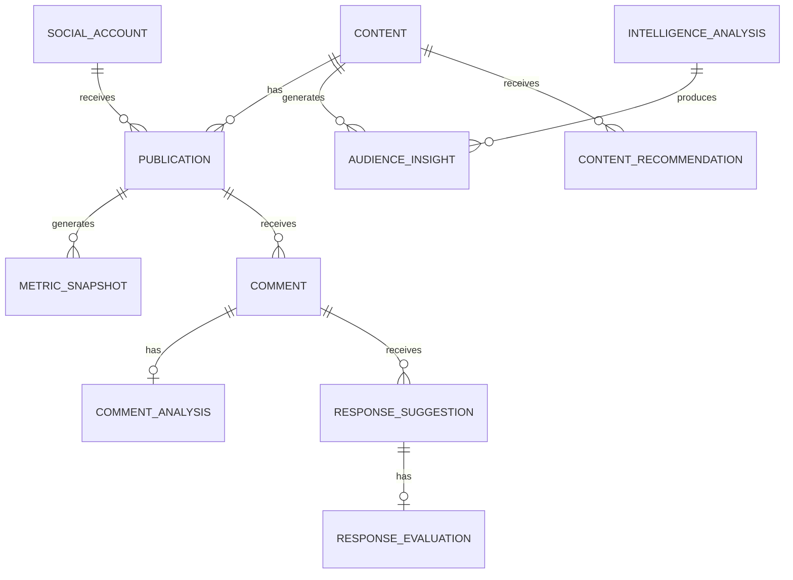

# Domain Model

## 1. Core Entities

### Content

Logical video/content asset.

### Publication

A platform-specific publication of a Content.

`Content → Publication[]`

### SocialAccount

An authorized social account.

### MetricSnapshot

Historical performance snapshot.

### Comment

Audience interaction associated with a Publication.

### CommentAnalysis

Structured evaluation of a Comment.

Suggested fields:

- sentiment
- emotion
- intent
- topic
- entity/character
- spamScore
- toxicityScore
- engagementValue
- confidence

### ResponseSuggestion

A proposed response to a Comment.

Suggested fields:

- text
- tone
- intent
- confidence
- sourceContext

### ResponseEvaluation

JEV evaluation of a proposed response.

Suggested fields:

- relevance
- tone
- helpfulness
- factualRisk
- toxicityRisk
- hallucinationRisk
- publishRecommendation
- confidence
- rationale

### AudienceInsight

Aggregated intelligence derived from comments, metrics and content context.

Examples:

- recurring topic;
- character popularity;
- repeated question;
- negative trend;
- engagement pattern.

### ContentRecommendation

Actionable recommendation for future content.

Examples:

- increase participation of a character;
- explore a recurring topic;
- address a common question;
- change CTA;
- create follow-up content.

### IntelligenceAnalysis

An auditable analysis execution containing input context, provider, result, confidence and timestamp.

## 2. Relationships

## 3. Domain Principle

AI artifacts are persisted as domain-relevant evidence, not as opaque text.

The system must be able to explain:

- what was evaluated;
- using which context;
- with which provider;
- with what confidence;
- what recommendation resulted.
