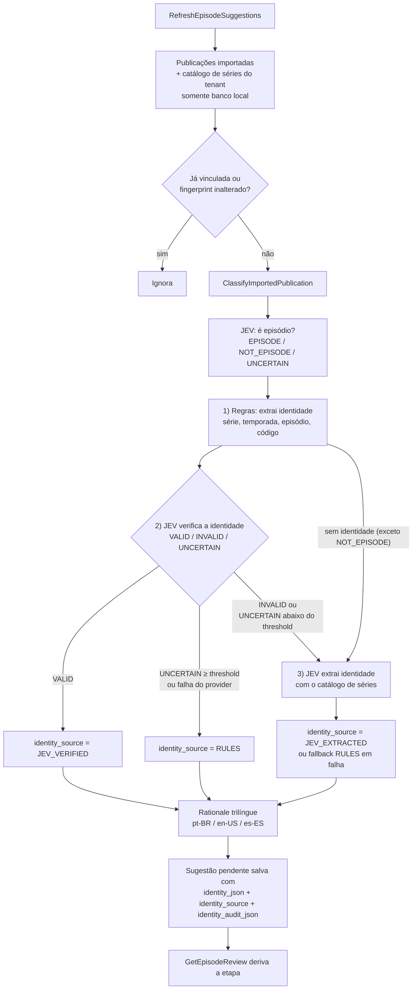
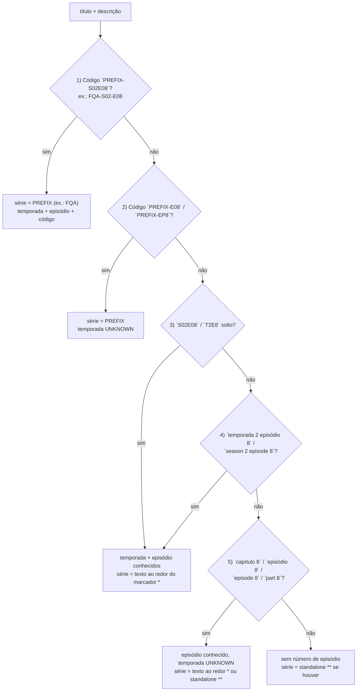
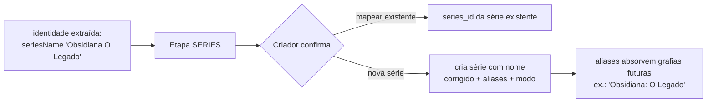
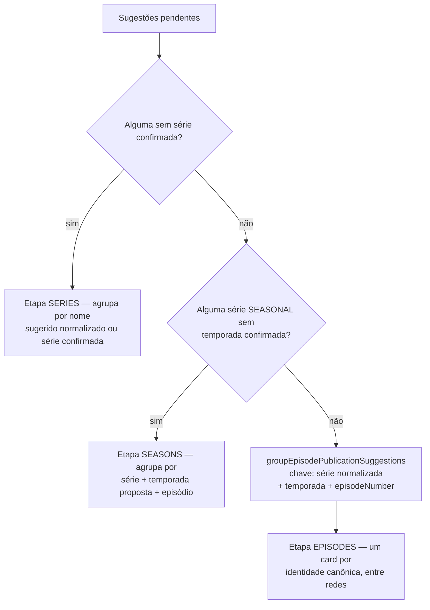
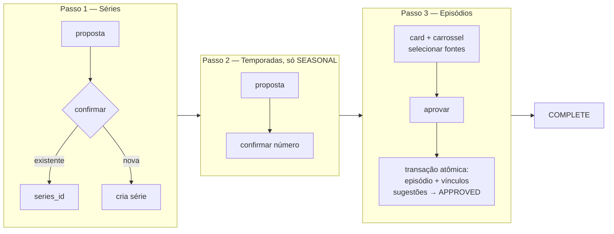

# Classificação de Séries e Episódios — Fluxos e Diagramas

**Status:** Referência  
**Specs relacionadas:** [Episode Setup Workflow](./technical-episode-setup-workflow.md), [Episode Identity Extraction Cascade](./technical-episode-identity-cascade.md), [Publication Analytics](./technical-analytics.md)
**Fonte da verdade (código):** `src/domain/analytics/episode-identity.ts`, `src/application/analytics/classify-imported-publication.ts`, `src/application/analytics/episode-review.usecases.ts`, `src/infrastructure/intelligence/jev-publication-episode-classifier.ts`

## 1. Visão geral — quem decide o quê

É importante separar três perguntas diferentes, respondidas por mecanismos diferentes:

| Pergunta | Quem responde | Como |
|---|---|---|
| "Esta publicação é um episódio?" | **IA (JEV)** | Uma pergunta `choice` ao modelo: `EPISODE` / `NOT_EPISODE` / `UNCERTAIN` |
| "Qual é a série / temporada / número?" | **Cascata: regras → verificação JEV → extração JEV** | Regex/heurísticas primeiro; o JEV verifica o resultado e, se rejeitado ou incerto, extrai a identidade com o catálogo de séries do tenant |
| "Essa série existe ou é nova?" | **O criador** | Confirmação manual na etapa 1 do workflow |

Ou seja: **não existe um classificador de "é série ou não"** nem auto-aprovação. A IA pode *verificar* e *extrair* a identidade proposta, mas tudo vira sugestão pendente — o criador confirma ou corrige. A extração JEV só referencia séries existentes pelo `id` exato do catálogo; `seriesId` desconhecido é rejeitado antes de persistir.

> **Nota sobre linha temporal:** `publishedAt` **não** é entrada da classificação nem do agrupamento. Serve só para exibição e para o fingerprint de mudança (pular re-classificação). Ver seção 8.

## 2. Pipeline de atualização (refresh)

Disparado por `POST /analytics/episodes/review/refresh` (`RefreshEpisodeSuggestions`). Para cada publicação importada, em paralelo conceitual:



A classificação (F) e a cascata de identidade (G→V→L) são independentes: a IA pode dizer `UNCERTAIN` mesmo quando as regras extraem um número de episódio, e vice-versa. Publicações `NOT_EPISODE` pulam a cascata de identidade. Cada publicação é avaliada isoladamente; falhas de verificação/extração são isoladas por fonte, registradas com código estável em `identity_audit_json`, e mantêm a identidade determinística — nunca abortam o lote nem descartam a sugestão.

## 3. O que a IA decide (e o que ela NÃO decide)

O `JevPublicationEpisodeClassifier` envia ao modelo **apenas**:

```json
{ "publication": { "platform": "...", "title": "...", "description": "..." } }
```

e faz uma pergunta do tipo `choice` (`episode_classification`):

- `EPISODE` — o texto dá evidência clara de que é um episódio/capítulo numerado de uma série recorrente;
- `NOT_EPISODE` — o texto dá evidência clara de que não é;
- `UNCERTAIN` — texto ausente, ambíguo ou insuficiente.

Se a publicação não tem título nem descrição, o modelo nem é chamado: um fallback `RULES` retorna `UNCERTAIN` sem confiança.

Quando a extração determinística produz identidade, uma segunda pergunta `choice` (`episode_identity_verification`) recebe o texto e a identidade candidata:

- `VALID` — o texto sustenta a identidade proposta → `identity_source = JEV_VERIFIED`;
- `INVALID` — o texto contradiz ou não sustenta → escala para extração;
- `UNCERTAIN` — texto insuficiente → escala só abaixo do threshold (`uncertainVerificationConfidenceThreshold = 0.6`); acima dele mantém `RULES`.

Na escalada, uma pergunta `json` (`episode_identity_extraction`) recebe o texto **e** a projeção do catálogo de séries do tenant (`{ id, name, aliases, seasonMode, knownSeasonNumbers }` — nunca métricas, contagens ou credenciais) e retorna JSON schema-validado:

```json
{
  "seriesRef": { "type": "existing", "seriesId": "..." },
  "seasonNumber": 2,
  "episodeNumber": 8,
  "episodeCode": "FQA-S02-E08",
  "confidence": 0.8
}
```

`seriesRef.type = "existing"` precisa ecoar um `id` do catálogo fornecido — IDs desconhecidos e temporada em série `NON_SEASONAL` são rejeitados antes de persistir. `type = "new"` propõe um nome que passa pela confirmação normal de série; `null` deixa a sugestão sem série. O resultado vira `identity_source = JEV_EXTRACTED`, sempre pendente de confirmação do criador.

A IA **não** recebe `publishedAt`, permalink, outras publicações, métricas nem histórico do criador. Cada chamada é auditável: veredicto/confiança da verificação e payload (ou código de falha) da extração ficam em `identity_audit_json`, com `model`, `schemaVersion` e `usage` nas colunas próprias.

## 4. Como o nome da série é extraído (determinístico — passo 1 da cascata)

`extractExplicitEpisodeIdentity(title, description)` roda matchers **em ordem**; o primeiro que casa define a identidade inteira. É a única etapa da cascata que não chama modelo:



### 4.1 Série pelo código (`PREFIX-...`)

Quando há um código tipo `FQA-S02-E08` ou `OBS-EP4`, o prefixo em maiúsculas vira o nome da série diretamente — sem heurística adicional. É o caminho mais confiável.

### 4.2 Série ao redor do marcador (`seriesNameAroundEpisodeMarker`)

Quando o número aparece como `Capítulo 8`, `S02E08`, etc., o algoritmo olha o texto **na mesma linha, antes e depois** do marcador, e gera candidatos com pontuação:

| Origem do candidato | Pontos |
|---|---|
| `... da série X` / `de novela X` depois do marcador | 6 |
| `| Nome` (pipe) depois do marcador | 6 |
| Texto antes do marcador na mesma linha | 5 se houver delimitador (`|`, `—`, `:`), 3 sem |
| Linha anterior inteira (≤100 caracteres) | 2 |

Antes de pontuar, cada candidato passa por `cleanSeriesNameCandidate`: remove pontuação/emoji das bordas, colapsa espaços e **rejeita** nomes que sejam só `episódio N`/`capítulo N`, ou que comecem com palavras genéricas (`no`, `em`, `ep`, `pov`, `que`, `mas`, `ele`, `ela`...). Vence o de maior pontuação; desempate pelo mais curto.

**Exemplo:** `Obsidiana O Legado | Capítulo 8` → antes do marcador há `Obsidiana O Legado |` com delimitador → série `Obsidiana O Legado` (5 pts).

### 4.3 Série "standalone" (`standaloneSeriesName`)

Quando não há marcador de episódio, ou o marcador não rendeu nome, o algoritmo varre todas as linhas buscando pistas de obra nomeada:

| Padrão | Pontos |
|---|---|
| `estreia: X`, `bastidores de X`, `acompanhe X`, `conhecer X`, `série: X`, `capítulos de X`, `reta final de X`... — o candidato precisa começar **capitalizado** (`o mundo de Elara` não conta) e para em delimitadores e termos temporais (`amanhã`, `hoje`) | 9 |
| Hashtag CamelCase com ≥3 palavras úteis (`#ObsidianaOLegado` → `Obsidiana O Legado`) | 8 + (nº palavras)/100 |
| `Nome | resto da legenda` | 7 |
| Hashtag de 1 palavra não genérica em linha com outra tag não genérica (`#Obsidiana` ao lado de `#OLegado`) | 6.5 |

Regras de corte: o nome precisa ter **≥2 palavras** normalizadas (a exceção é a hashtag de 1 palavra acima), hashtags compostas só de palavras genéricas (`novela`, `serie`, `microdrama`, `romance`, `vertical`, `agegap`...) são descartadas, e candidatos no formato de par de nomes `X e Y` (típico de nomes de personagens) sofrem **-3 pontos**. Vence o maior score; desempate pelo nome mais longo.

### 4.4 Sem heurísticas específicas de série

A extração determinística é **genérica**: não existem regras ad hoc por série ou por tenant. Arcos nomeados como `Obsidiana: O Legado` aparecem como candidatos normais (ex.: `seriesName = 'OBSIDIANA: O LEGADO'`, temporada desconhecida) e o mapeamento para a série canônica acontece pelos caminhos normais — verificação/extração JEV com o catálogo de séries do tenant (ver [Episode Identity Extraction Cascade](./technical-episode-identity-cascade.md)), aliases confirmados pelo criador e a confirmação explícita nas etapas de setup.

### 4.5 Normalização para agrupar

`normalizeSeriesIdentity` tira acentos, baixa tudo, troca não-alfanumérico por espaço e **descarta conectores e artigos insignificantes** (`de`, `do`, `da`, `dos`, `das`, `e`, `o`, `a`, `os`, `as`, `um`, `uma`, `of`, `the`, `an`, `el`, `la`, `los`, `las`): `Fora de Roteiro` e `Fora Do Roteiro` → `fora roteiro`, `Obsidiana: O Legado` → `obsidiana legado`. É essa forma normalizada que junta variações de escrita na mesma proposta de série, na mesma chave de episódio e no match de aliases — evitando propostas duplicadas por preposição ou artigo.

## 5. Da sugestão à série confirmada

A extração produz apenas uma **sugestão**. A série só passa a existir de fato quando o criador confirma:



## 6. Etapas e agrupamento de episódios

`GetEpisodeReview` recalcula a etapa no servidor a cada leitura. A identidade usada depende de `identity_source`:

- `JEV_EXTRACTED` (e o futuro `LEARNED_PATTERN`) → usa a identidade **persistida** em `identity_json` (imutável pós-persist; mudança de fingerprint gera uma nova revisão);
- legado (`NULL`), `RULES` e `JEV_VERIFIED` → **re-deriva** pelo extrator atual, então uma melhoria nas heurísticas corrige sugestões antigas.



A chave de agrupamento é `série normalizada : season:N|seasonless : episodeNumber`. Plataforma, conta, permalink, legenda e **data nunca entram na chave** — o mesmo episódio no Instagram/TikTok/YouTube/Facebook vira um único card com carrossel de fontes.

Sugestões que não entram em grupo ficam `unmatched` com motivo explícito:

| Motivo | Condição |
|---|---|
| `NOT_EPISODE` / `UNCERTAIN` | resultado do classificador |
| `IDENTITY_INCOMPLETE` | sem nome de série ou número inválido |
| `SEASON_UNKNOWN` | temporada não explícita e não confirmada |
| `SERIES_SEASON_MODE_CONFLICT` | identidade conflita com o modo da série |
| `IDENTITY_SINGLE` | bucket com uma única fonte — sem corroboração entre redes |
| `IDENTITY_CONFLICT` | mesma chave, códigos de episódio diferentes |

## 7. Aprovação e persistência



Na aprovação, `approveGroup` valida a consistência do grupo pela mesma regra: identidade persistida para fontes extraídas por modelo, re-derivação para as demais.

O registro manual (`POST /analytics/series`, `POST /analytics/episodes/manual`) ignora a classificação: o criador escolhe até uma publicação não vinculada por rede; o servidor resolve as fontes do banco, cria episódio + vínculos atomicamente e marca sugestões pendentes como `APPROVED`.

## 8. A classificação considera a linha temporal?

**Não.** A dimensão cronológica não é usada em nenhuma etapa:

- O JEV recebe só `platform`, `title`, `description` — sem `publishedAt` e sem publicações vizinhas.
- A extração de identidade é regex/heurística por texto, sem análise de sequência.
- As chaves de agrupamento não contêm data; fontes com a mesma identidade agrupam independente de quando foram publicadas.
- `publishedAt` só aparece no `episodePublicationFingerprint` (pular re-classificação se nada mudou) e como metadado de exibição.

**Implicação:** o número explícito no texto sempre vence a cronologia. Publicar fora de ordem funciona, mas nada detecta "E10 antes de E09" ou reúso do mesmo número meses depois em outra temporada. Detectar isso exigiria regras novas ou incluir `publishedAt`/publicações irmãs no input do modelo, com atualização das specs.
