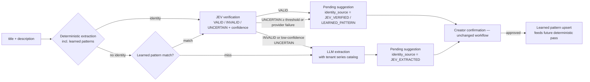

# Technical Specification — Episode Identity Extraction Cascade

**Status:** Proposal  
**Parent specification:** [Episode Setup Workflow](./technical-episode-setup-workflow.md)  
**Reference document:** [Episode and Series Classification — Flows](./episode-classification-flow.md)

## 1. Scope

Evolve how `seriesName`/`seasonNumber`/`episodeNumber`/`episodeCode` are derived from imported publication metadata. Today identity is a pure function of `title` + `description` computed by deterministic regex/heuristics (`extractExplicitEpisodeIdentity`), which fails on captions outside the expected formats and previously required a hard-coded arc rule (the `Obsidiana` rule, removed in increment 1 — deterministic extraction is now fully generic).

This proposal introduces a **cascade**: deterministic rules stay the primary path, JEV verifies the deterministic result, an LLM extracts identity only on rejection or insufficient confidence, and creator-approved LLM extractions feed a tenant-scoped learned-pattern table that reduces future model calls.



## 2. Architectural Placement

- **Domain:** deterministic extraction and grouping rules are unchanged. Add a pure `matchLearnedIdentityPattern` lookup evaluated inside the deterministic pass. Persisted `identity_source` and extracted identity on suggestions become domain-owned metadata; identity is no longer re-derivable for model-extracted rows.
- **Application:** `ClassifyImportedPublication` orchestrates the cascade and records provenance. `GetEpisodeReview` stops re-deriving identity for suggestions that carry a persisted extracted identity; legacy rows without `identity_source` keep the current re-derivation behavior for backward compatibility.
- **Ports:** extend `PublicationEpisodeClassifier` (or add a sibling port) with `verifyEpisodeIdentity` and `extractEpisodeIdentity`. Add `EpisodeIdentityPatternRepository` for tenant-scoped learned patterns and a `listSeriesCatalog` read (names, aliases, seasonMode, known season numbers) reused from the episode-review repository.
- **Adapters:** `JevPublicationEpisodeClassifier` adds two schema-validated questions; PostgreSQL repository for patterns; no new HTTP surface — the cascade is internal to refresh.
- **JEV boundaries (unchanged):** JEV receives normalized metadata plus the series catalog projection. It never reads the database, never calls social APIs, never mutates domain state, and its output always lands as a creator-reviewable suggestion.

## 3. Cascade Order and Contracts

### Step 1 — Deterministic extraction

Run `extractExplicitEpisodeIdentity` plus the learned-pattern lookup (section 5). Any non-null `seriesName` + `episodeNumber`, or an explicit code, proceeds to verification with `identity_source` candidate `RULES`; a learned-pattern hit proceeds with `LEARNED_PATTERN`. Nothing here may call a model.

### Step 2 — JEV verification

New choice question `episode_identity_verification` sent with the untrusted text and the candidate identity:

- `VALID` — the text supports the proposed series/season/episode identity.
- `INVALID` — the text contradicts or does not support the identity.
- `UNCERTAIN` — insufficient text to decide.

`VALID` accepts the deterministic identity and records `identity_source = JEV_VERIFIED` (deterministic identity confirmed by the model). `INVALID`, or `UNCERTAIN` below the configured confidence threshold, escalates to step 3. `UNCERTAIN` at or above the threshold — and any provider failure during verification — keeps the deterministic identity as `RULES`. The threshold is the named application constant `uncertainVerificationConfidenceThreshold` (currently `0.6`), not user input.

### Step 3 — LLM extraction with series catalog

Only on escalation, a structured `json` question `episode_identity_extraction` receives the text **and** the tenant series catalog projection: `{ id, name, aliases, seasonMode, knownSeasonNumbers }` per series — never metrics, counts, or credentials. The model returns schema-validated JSON:

```json
{
  "seriesRef": { "type": "existing" | "new", "seriesId": "...", "name": "..." },
  "seasonNumber": 2,
  "episodeNumber": 8,
  "episodeCode": "OBS-S02-E08",
  "confidence": 0.0
}
```

`type: "existing"` must echo a `seriesId` present in the supplied catalog; unknown IDs are rejected. `type: "new"` returns a proposed name that flows through the normal series-confirmation step. Missing fields stay null — the result may still yield an `IDENTITY_INCOMPLETE`/`SEASON_UNKNOWN` suggestion rather than being forced. Every extraction is persisted as a pending suggestion with `identity_source = JEV_EXTRACTED`; it never bypasses creator confirmation.

## 4. Identity Persistence Change

Add `identity_source` (`RULES | LEARNED_PATTERN | JEV_VERIFIED | JEV_EXTRACTED`) and `identity_audit_json` (catalog size, verification verdict/confidence, extraction payload or a stable failure code) to `analytics_episode_suggestions` in a new migration; the extracted identity itself rides the existing `identity_json` column. `GetEpisodeReview` uses the persisted identity when present; it re-derives identity only for legacy rows and `RULES`/`JEV_VERIFIED` rows so a text change still revokes stale deterministic identities. Model-extracted identities are immutable post-persist — a changed source fingerprint produces a new revision, matching the existing decision-history rule — and `approveGroup` validates group consistency against the persisted `identity_json` for `JEV_EXTRACTED`/`LEARNED_PATTERN` rows instead of re-deriving.

## 5. Learned Identity Patterns

New table `analytics_episode_identity_patterns`, tenant-scoped:

- `signature_type` + normalized `signature_value`: `HASHTAG`, `CODE_PREFIX`, or `TITLE_PREFIX` (literal prefix, not generated regex).
- `series_id` (tenant-scoped FK) and identity template: fixed `season_number` or `season_mode_marker`, optional `episode_code` format.
- Provenance: `origin_suggestion_id`, `created_by`, `created_at`, `times_applied`, `last_applied_at`.

Rules:

- A pattern is written **only** when a `JEV_EXTRACTED` (or `JEV_VERIFIED` with learned mapping) identity is confirmed by an explicit creator series/episode approval. Manual registration does not create patterns.
- Patterns produce deterministic *candidates* only — first applications still surface for creator review; learned patterns never auto-confirm, auto-link, or edit series/aliases.
- Pattern matching is literal/exact-normalized (`normalizeSeriesIdentity` semantics), never a synthesized regex.
- Signature conflicts across tenants are impossible by key `(tenant_id, signature_type, signature_value)`; a conflicting re-approval updates the mapping with the newer decision audit.
- Do not auto-generate `series.aliases` from patterns; the existing alias mechanism remains creator-controlled.

## 6. Series Catalog Context

- Contents per series: `id`, `name`, `aliases`, `seasonMode`, and the set of confirmed season numbers.
- Catalog is read tenant-scoped at refresh time, once per batch, and passed through the port input — the adapter never queries persistence itself.
- Record the catalog size/hash in the suggestion evidence so classifications remain auditable even though identical text may classify differently as the catalog evolves.

## 7. Validation and Failure Handling

- A failed verification or extraction leaves the deterministic result untouched: keep the suggestion with its deterministic identity and `UNCERTAIN`-style status rather than dropping it.
- Verification/extraction failures are isolated per source, recorded with a stable failure code, and do not abort the refresh batch.
- `existing` series references that do not resolve in the tenant catalog are rejected before persistence.
- Learned-pattern writes occur inside the existing approval transaction so a rolled-back approval cannot leave an orphaned pattern.
- Fingerprint semantics are unchanged: an unchanged source is never re-classified; a changed one re-runs the full cascade.

## 8. Security, Localization, and Observability

- Tenant scoping on catalog reads, pattern reads/writes, and suggestion persistence.
- Never log raw AI payloads, publication descriptions, credentials, or tokens; record tenant, source identity, cascade step reached, `identity_source`, safe failure codes, model/schema version, and timestamps.
- No new user-facing strings are required; rationale variants continue to cover the three locales.

## 9. Verification

- **Unit:** cascade ordering (deterministic → verify → extract), escalation conditions incl. confidence threshold, catalog-context contract (`existing` vs `new`, unknown `seriesId` rejection), learned-pattern matching precedence (after explicit codes, before generic heuristics/LLM), pattern upsert only on explicit approval, persisted-identity reads vs legacy re-derivation, per-source failure isolation.
- **Integration:** migration constraints and tenant scoping for `identity_source` + patterns table; pattern write inside the approval transaction; catalog read shape.
- **E2E:** deterministic doubles driving each cascade branch; a rejected deterministic identity replaced by an LLM extraction that maps to an existing series; approval of an LLM-extracted identity creates a pattern; a later publication with the same signature resolves deterministically without a model call.
- **AI:** deterministic stub for JEV verification/extraction; never live model output as oracle.

## 10. Increment Status

- **Increment 1 (implemented):** deterministic extraction → `episode_identity_verification` → `episode_identity_extraction` with the tenant series catalog; `identity_source` + `identity_audit_json` persisted; `GetEpisodeReview`/`approveGroup` honor persisted model-extracted identities; per-source failure isolation. Learned-pattern table, pattern writes on approval, and `LEARNED_PATTERN` matching are **not** implemented — the `LEARNED_PATTERN` enum value is reserved.
- **Later increments:** `analytics_episode_identity_patterns` table and upsert inside the approval transaction; learned-pattern deterministic lookup before LLM escalation.

## 11. Open Decisions

- Confidence threshold value and whether it is global or per-platform.
- Whether learned patterns apply only after N creator approvals or immediately after the first.
- Whether `JEV_VERIFIED` suggestions expose a distinct review badge to signal model-confirmed deterministic identity.
- Pattern expiration/deprecation when the underlying series is renamed or deleted.
