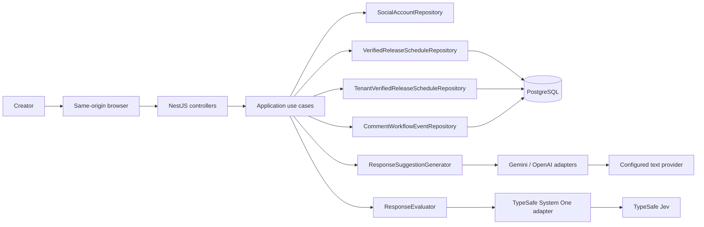

# Technical Specification - Verified Release Schedule Context

**Status:** V1 implemented with tenant-global defaults; daylight-saving guidance remains open.
**Product PRD:** [Verified Release Schedule Context](../product/prds/verified-release-schedule.md)
**Related specifications:** [Technical Community Management](technical-community-management.md) · [Generate Response Suggestion](comments/generate-response.md) · [Evaluate Response](comments/evaluate-response.md) · [TypeSafe Jev Integration](../integrations/jev.md) · [Implemented Hexagonal Architecture](../architecture/arquitetura-hexagonal-implementada.md)
**Related ports:** [ResponseSuggestionGenerator](../../src/application/ports/response-suggestion-generator.port.ts) · [ResponseEvaluator](../../src/application/ports/response-evaluator.port.ts)

## 1. Scope and Invariants

Store a creator-confirmed weekly release schedule at two scopes — a tenant-wide global default and an optional per-account override for one tenant-owned connected social account — and make the effective active facts available to that account's manually requested response generation and optional response evaluation.

The word "verified" means explicitly saved and confirmed by the creator. The application does not verify the schedule with a social platform or external calendar.

V1 invariants:

- There is at most one current schedule per `tenantId` (the global default) and at most one current schedule per `(tenantId, socialAccountId)` (the account override). The global default applies to every account in the tenant that has no account row.
- The effective schedule for an account resolves in the order account → tenant → unconfigured. Any persisted account row — including an explicitly disabled one — is the effective schedule for that account; a disabled account row wins over an active global schedule. With no account row, the tenant schedule is the effective schedule; with neither, the effective status is `UNCONFIGURED`.
- Only a persisted, explicitly confirmed, enabled effective schedule is active context. A missing schedule is not an error; a disabled effective schedule is not active context.
- The local weekdays and wall-clock time use the selected IANA time zone. The local time and zone are one fact and must always be stored and supplied together. Neither is inferred from locale, browser, host, IP address, or presumed creator location.
- An unsaved editor value, comment, sent reply, previous suggestion, or workflow event cannot create, fill, or confirm a schedule at either scope.
- Active schedule facts may be sent only to the configured Gemini/OpenAI generator for that account's explicit suggestion request, or to TypeSafe for that account's explicit response evaluation.
- No scheduler, publication job, implicit response generation, response send, or change to the manual-send policy is introduced.

## 2. Architecture Placement

Keep orchestration in application use cases, account-independent schedule types free of infrastructure concerns, HTTP DTOs in the presentation adapter, SQL in the persistence adapter, and Gemini/OpenAI/TypeSafe payloads in their respective intelligence adapters.



The browser supplies an account ID and ordinary schedule fields, never a tenant ID, confirmed schedule, schedule snapshot, provider payload, or evaluation result. The application resolves the tenant and account before it reads or changes schedule data. JEV and the text providers receive only application-prepared context; they do not read persistence or social APIs.

### Generation sequence

```mermaid
sequenceDiagram
    actor Creator
    participant HTTP as NestJS controller
    participant UC as GenerateCommentResponseSuggestion
    participant Account as SocialAccountRepository
    participant Comment as SocialCommentRepository
    participant Schedule as VerifiedReleaseScheduleRepository
    participant Generator as ResponseSuggestionGenerator
    participant Text as Gemini/OpenAI adapter
    participant Events as CommentWorkflowEventRepository

    Creator->>HTTP: Explicit generation request
    HTTP->>UC: accountId + externalCommentId
    UC->>Account: findById(tenantId, accountId)
    UC->>Comment: load comment and existing analysis
    Note over UC: Existing analysis precondition still applies
    UC->>Schedule: get(tenantId, accountId)
    Schedule-->>UC: null, disabled row, or active row
    UC->>Schedule: tenant-level get(tenantId) when no account row
    Schedule-->>UC: null, disabled row, or active row
    Note over UC: Resolve one immutable snapshot for this request<br/>account row wins; disabled account row beats active tenant row
    loop pt-BR, en-US, es-ES
        UC->>Generator: comment + analysis + tone + schedule context + language
        Generator->>Text: Provider-specific structured request
        Text-->>Generator: Validated suggestion or stable failure
        Generator-->>UC: Independent language outcome
        UC->>Events: Append this variant/failure and its schedule snapshot
    end
    UC-->>HTTP: Independent variant and failure outcomes
    HTTP-->>Creator: Reviewable suggestions; no send
```

### Response-evaluation sequence

```mermaid
sequenceDiagram
    actor Creator
    participant HTTP as NestJS controller
    participant UC as EvaluateResponseSuggestion
    participant Account as SocialAccountRepository
    participant Comment as SocialCommentRepository
    participant Schedule as VerifiedReleaseScheduleRepository
    participant Evaluator as ResponseEvaluator
    participant Jev as TypeSafe System One adapter
    participant Events as CommentWorkflowEventRepository

    Creator->>HTTP: Explicit evaluation request for saved revision
    HTTP->>UC: accountId + commentId + revisionEventId
    UC->>Account: Verify account in tenant
    UC->>Comment: Load comment, analysis, and latest saved revision
    UC->>Schedule: get(tenantId, accountId), then tenant-level get(tenantId) when no account row
    Schedule-->>UC: Effective disabled/active row or none
    Note over UC: Add schedule_consistency only for active context
    UC->>Evaluator: Exact response + analysis + optional active schedule
    Evaluator->>Jev: State + independent typed questions
    Jev-->>Evaluator: Structured typed answers
    Evaluator-->>UC: Validated evaluation; no explanation text
    UC->>Events: Append evaluation and resolved schedule snapshot
    UC-->>HTTP: Advisory evaluation
    HTTP-->>Creator: Display advice; no send or block
```

## 3. Model and Application Port

### Schedule model

Define the account configuration and its invariants in `src/domain/social/verified-release-schedule.ts`. Keep the repository contract in `src/application/ports/verified-release-schedule.repository.port.ts`; neither boundary imports NestJS, SQL, Gemini/OpenAI, or TypeSafe types:

```ts
type ReleaseScheduleDay =
  | 'MONDAY'
  | 'TUESDAY'
  | 'WEDNESDAY'
  | 'THURSDAY'
  | 'FRIDAY'
  | 'SATURDAY'
  | 'SUNDAY';

interface VerifiedReleaseScheduleConfig {
  readonly enabled: boolean;
  readonly daysOfWeek: readonly ReleaseScheduleDay[];
  readonly localTime: string; // HH:mm, local wall-clock time in timeZone
  readonly timeZone: string; // IANA identifier, e.g. America/Sao_Paulo; also scopes daysOfWeek
}

interface StoredVerifiedReleaseSchedule extends VerifiedReleaseScheduleConfig {
  readonly version: number;
  readonly updatedAt: string;
  readonly confirmedAt: string;
}
```

Every persisted row is explicitly confirmed; `confirmedAt` is therefore non-null. Absence is represented by no row, not by a synthesized default schedule. An unconfigured editor starts with `enabled: false`, no selected days, and no local time; its `America/Sao_Paulo` time-zone selection is presentation state only.

Resolve an immutable audit snapshot before a generation/evaluation provider call. The snapshot records which scope supplied the row (`ACCOUNT` or `TENANT`); `UNCONFIGURED` carries no source because no row exists at either scope:

```ts
type VerifiedReleaseScheduleSource = 'ACCOUNT' | 'TENANT';

type VerifiedReleaseScheduleSnapshot =
  | { readonly status: 'UNCONFIGURED'; readonly schedule: null }
  | { readonly status: 'DISABLED'; readonly schedule: StoredVerifiedReleaseSchedule; readonly source: VerifiedReleaseScheduleSource }
  | { readonly status: 'ACTIVE'; readonly schedule: StoredVerifiedReleaseSchedule; readonly source: VerifiedReleaseScheduleSource };
```

Store this resolved snapshot with the workflow artifact. If the repository read fails before resolution, the failure event may store a `null` snapshot plus `VERIFIED_RELEASE_SCHEDULE_UNAVAILABLE`; `null` means "not resolved" and is not equivalent to `UNCONFIGURED`. The provider-facing generation projection is deliberately smaller:

```ts
type ResponseGenerationScheduleContext =
  | {
      readonly status: 'ACTIVE';
      readonly daysOfWeek: readonly ReleaseScheduleDay[];
      readonly localTime: string;
      readonly timeZone: string;
    }
  | { readonly status: 'UNCONFIGURED' | 'DISABLED' };
```

For a disabled schedule, the audit snapshot can preserve the saved configuration and version, while the provider projection contains only `DISABLED`; inactive day/time values are not usable model facts. Evaluation receives schedule facts only in the active case.

### Repository port

Add application ports `VerifiedReleaseScheduleRepository` and `TenantVerifiedReleaseScheduleRepository` in `src/application/ports/`:

```ts
interface VerifiedReleaseScheduleRepository {
  get(tenantId: string, socialAccountId: string): Promise<StoredVerifiedReleaseSchedule | null>;
  save(
    tenantId: string,
    socialAccountId: string,
    config: VerifiedReleaseScheduleConfig,
  ): Promise<StoredVerifiedReleaseSchedule>;
}

interface TenantVerifiedReleaseScheduleRepository {
  get(tenantId: string): Promise<StoredVerifiedReleaseSchedule | null>;
  save(tenantId: string, config: VerifiedReleaseScheduleConfig): Promise<StoredVerifiedReleaseSchedule>;
}
```

Each repository is always called with its scope identifier. Neither resolves tenants, parses HTTP DTOs, infers ownership, or contacts an external service. V1 does not require a schedule-delete method at either scope.

### Effective resolution

```ts
function resolveVerifiedReleaseSchedule(
  accountRow: StoredVerifiedReleaseSchedule | null,
  tenantRow: StoredVerifiedReleaseSchedule | null,
): { source: 'ACCOUNT' | 'TENANT' | 'UNCONFIGURED'; schedule: StoredVerifiedReleaseSchedule | null } {
  if (accountRow) return { source: 'ACCOUNT', schedule: accountRow };
  if (tenantRow) return { source: 'TENANT', schedule: tenantRow };
  return { source: 'UNCONFIGURED', schedule: null };
}
```

The resolved row maps to the audit snapshot: `enabled` becomes `ACTIVE` with `source: 'ACCOUNT' | 'TENANT'`; `!enabled` becomes `DISABLED` with the same source; no row becomes `UNCONFIGURED` without a source.

### Use cases

- `GetVerifiedReleaseSchedule`: resolve `PilotTenantContext`, parse the account ID, confirm the account with `SocialAccountRepository.findById(tenantId, accountId)`, then resolve the effective schedule through `resolveVerifiedReleaseSchedule`. Return the effective view — schedule plus `source` — so the client can distinguish account overrides from inherited tenant rows and from `UNCONFIGURED`.
- `GetTenantVerifiedReleaseSchedule`: resolve `PilotTenantContext` and return the tenant schedule view (`source: 'TENANT'` when configured, otherwise `UNCONFIGURED`).
- `UpdateVerifiedReleaseSchedule`: resolve and confirm the same tenant-owned account, validate the complete request, then save it. A successful `PUT` is the creator's explicit save/confirmation; no separate draft or background confirmation exists. Saving an account row — including a disabled one — makes it the effective schedule for that account.
- `UpdateTenantVerifiedReleaseSchedule`: resolve `PilotTenantContext`, validate the complete request, then save it as the tenant-wide default. The same validation rules apply at both scopes.
- `GenerateCommentResponseSuggestion`: after the existing account, comment, and analysis checks, read the account schedule row and the tenant row for that exact tenant, resolve one effective immutable snapshot via `resolveVerifiedReleaseSchedule`, and use that snapshot for all three language calls.
- `EvaluateResponseSuggestion`: preserve the existing manual action, current-response-version check, and comment-analysis precondition. Resolve the effective schedule for the comment's account through the same hierarchy before calling `ResponseEvaluator`; persist the resolved snapshot with the evaluation or evaluation failure.

No use case reads comment or response history to resolve schedule facts. The existing `ResponseToneProfile` is loaded and snapshotted independently and is not changed by this feature.

## 4. HTTP DTOs and Routes

Use the existing account-settings route convention, plus tenant-scoped routes for the global default:

```http
GET /social/accounts/{accountId}/verified-release-schedule
PUT /social/accounts/{accountId}/verified-release-schedule

GET /social/settings/verified-release-schedule
PUT /social/settings/verified-release-schedule
```

The account controller accepts `accountId` only; the tenant controller accepts no scope parameter. Tenant scoping is resolved inside the application through `PilotTenantContext`, matching the existing response-tone settings boundary. Callers can never supply a tenant ID.

The account `GET` returns `200 OK` with the *effective* schedule — the account row when one exists (even disabled), otherwise the tenant row, otherwise an explicit empty state. The `source` field reports the scope that supplied the schedule:

```json
{ "schedule": null, "source": "UNCONFIGURED" }
```

When configured:

```json
{
  "schedule": {
    "enabled": true,
    "daysOfWeek": ["MONDAY", "WEDNESDAY"],
    "localTime": "20:30",
    "timeZone": "America/Sao_Paulo",
    "version": 1,
    "updatedAt": "ISO-8601 timestamp",
    "confirmedAt": "ISO-8601 timestamp"
  },
  "source": "ACCOUNT"
}
```

`source` is `ACCOUNT` when an account row supplies the schedule and `TENANT` when the account inherits the global default. The tenant `GET` uses the same envelope with `source` equal to `TENANT` or `UNCONFIGURED`.

`PUT` is a complete replacement and an explicit save/confirmation, not a patch, at either scope. The account `PUT` writes the account row (making it the effective schedule for that account); the tenant `PUT` writes the global default. A successful write returns `200 OK`:

```json
{
  "enabled": true,
  "daysOfWeek": ["MONDAY", "WEDNESDAY"],
  "localTime": "20:30",
  "timeZone": "America/Sao_Paulo"
}
```

Neither request accepts `version`, `updatedAt`, `confirmedAt`, `tenantId`, actor identity, or a schedule snapshot. The response uses the same envelope as `GET`. A missing schedule is not represented by default days or time. There is no `DELETE` route in v1; a saved schedule can be disabled through `PUT`. A disabled account row is itself an override: it suppresses an active global schedule for that account.

Generation and evaluation request bodies remain unchanged. Clients cannot pass a schedule to either workflow; the application resolves it from the comment's connected account.

## 5. Validation and Stable Errors

Validate at the HTTP boundary and again in the application/domain boundary so direct use-case calls cannot bypass invariants:

- Reject non-object bodies, unknown keys, and missing required fields.
- `enabled` must be boolean.
- `daysOfWeek` must be an array of known enum values with no duplicates. An enabled schedule must contain at least one day; a disabled schedule may contain no days. `localTime` and `timeZone` remain required for both states.
- `localTime` must match 24-hour `HH:mm` with hours `00`-`23` and minutes `00`-`59`.
- `timeZone` must be accepted by the runtime IANA time-zone database (`Intl.DateTimeFormat`); validate it without deriving a replacement from the machine or user locale and preserve the exact accepted identifier. Populate the UI selector from `Intl.supportedValuesOf('timeZone')`, always include `America/Sao_Paulo` and `UTC`, and retain a currently saved valid identifier even if it is an alias omitted from the runtime's canonical list.
- `version` and timestamps are server-owned and cannot be supplied by a client.
- A disabled schedule is never projected to an AI provider as active day/time facts.

Return stable error codes using the existing `{ "code": "..." }` API shape:

| Condition | HTTP status | Code |
| --- | ---: | --- |
| Invalid schedule DTO or field value | 400 | `VERIFIED_RELEASE_SCHEDULE_INVALID` |
| Invalid account ID | 400 | `SOCIAL_ACCOUNT_ID_INVALID` |
| Account missing or not owned by the resolved tenant | 404 | `SOCIAL_ACCOUNT_NOT_FOUND` |
| Schedule storage unavailable | 503 | `VERIFIED_RELEASE_SCHEDULE_UNAVAILABLE` |
| Persisted schedule cannot be validated | 500 | `VERIFIED_RELEASE_SCHEDULE_DATA_INVALID` |
| Unexpected schedule settings failure | 500 | `VERIFIED_RELEASE_SCHEDULE_FAILED` |

No configured schedule is a valid `200` result, not a `404`. Do not reveal whether an account ID belongs to another tenant. Existing comment, analysis, response-version, and intelligence-provider errors remain unchanged.

## 6. Persistence

Add an additive PostgreSQL migration after the latest existing migration number (currently `017`, so the implementation uses `018`). The table is:

```sql
CREATE TABLE social_account_verified_release_schedules (
  tenant_id UUID NOT NULL,
  social_account_id UUID NOT NULL,
  enabled BOOLEAN NOT NULL,
  days_of_week TEXT[] NOT NULL,
  local_time TIME WITHOUT TIME ZONE NOT NULL,
  time_zone TEXT NOT NULL,
  version INTEGER NOT NULL CHECK (version > 0),
  updated_at TIMESTAMPTZ NOT NULL,
  confirmed_at TIMESTAMPTZ NOT NULL,
  PRIMARY KEY (tenant_id, social_account_id),
  FOREIGN KEY (tenant_id, social_account_id)
    REFERENCES social_accounts (tenant_id, id) ON DELETE CASCADE
);
```

Application validation enforces enum membership, duplicate rejection, enabled-day requirements, and IANA validity. A database constraint may also enforce the day enum and non-empty active days. `local_time` is stored without a time zone; `time_zone` is stored separately as the IANA identifier. Do not convert `local_time` to UTC or calculate publication instants.

`PostgresVerifiedReleaseScheduleRepository` scopes every query by both key columns. `PostgresTenantVerifiedReleaseScheduleRepository` scopes every query by `tenant_id` only and persists the global default in `tenant_verified_release_schedules` (migration `021`), keyed by `tenant_id` and cascading with the tenant row. Its shape mirrors the account table minus `social_account_id`. Both upserts return the saved row. The version starts at `1` and increments on every accepted explicit `PUT`, including an identical value; `updated_at` and `confirmed_at` are server timestamps from the same save/confirmation. Concurrent writes use last-write-wins; v1 does not require an ETag or expected-version field. The tables store the current schedule only, not a complete history of every edit. Old schedule facts used by suggestions/evaluations remain available in their immutable workflow snapshots. The account-level row remains for the connected-account lifetime and is removed with that account.

The account foreign key follows the existing account-owned settings pattern; the tenant foreign key follows the tenant-scoped settings pattern. The migration and repository tests must verify tenant/account isolation and the account/tenant relationships. Account rows are removed with their account; there is no separate schedule expiry at either scope.

## 7. Response Generation Integration

The generation path remains creator-initiated and requires the existing successful comment analysis. It continues to load the account tone profile and generate independent `pt-BR`, `en-US`, and `es-ES` variants.

1. Resolve the tenant, account, comment, and analysis using the current use case.
2. Read the account schedule row using `(tenantId, account.id)` and the tenant schedule row using `tenantId`, then resolve the effective schedule (account row wins; a disabled account row suppresses an active tenant row). Do not read the schedule from a publication ID, another account, comment history, sent replies, or previous suggestions.
3. Resolve the result to `UNCONFIGURED`, `DISABLED`, or `ACTIVE` and capture the complete immutable audit snapshot, including version, timestamps, and `source` (`ACCOUNT` or `TENANT`) when a row exists.
4. Build a provider-facing context. For `ACTIVE`, include the exact selected days, `localTime`, and `timeZone` together. For `UNCONFIGURED` or `DISABLED`, include only the status and no day/time facts.
5. Pass the same resolved provider context to each language call in that request; retain the version in each audit snapshot, not in the provider prompt. A schedule update during the provider calls affects a later generation request, not only some variants of the current one.
6. Pass active schedule facts for each generation request and use a prompt-level relevance rule: Gemini/OpenAI must mention the schedule only when the comment concerns release timing, frequency, or continuation; never infer a schedule from a continuation request; and never assert days/times without active context. V1 adds no deterministic relevance classifier. Without active context, cautious wording for creator review is allowed. Do not calculate the next calendar occurrence or convert the supplied local time.
7. Append each successful variant as its own existing workflow event, with a distinct `verifiedReleaseScheduleSnapshot` alongside its language, tone snapshot, source analysis, provider/model, and generation metadata. Include the snapshot in each per-language failure event as well so partial outcomes remain auditable.

The application passes only schedule facts required to write the response, not internal tenant/account identifiers or unrelated schedule history. The generator returns a suggestion; it does not trigger evaluation, revision approval, or send.

Extend the `ResponseSuggestionGenerator` application-port input with a required `verifiedReleaseSchedule` context union. Keep Gemini/OpenAI HTTP DTOs and prompt serialization inside their adapters. Their routine integration tests capture the outgoing structured JSON and assert the exact local time and matching IANA identifier.

If the schedule read fails, do not silently represent the failure as `UNCONFIGURED`. Fail closed before any text-provider call and record a `VERIFIED_RELEASE_SCHEDULE_UNAVAILABLE` failure for each language with a `null` schedule snapshot (`null` means "not resolved", not "unconfigured").

## 8. TypeSafe Response Evaluation Integration

Response evaluation remains a distinct, optional, manually requested action against the exact latest saved response version. The existing comment-analysis requirement, typed evaluation questions, confidence/evidence validation, and `rationale: null` behavior remain in force.

When the resolved schedule snapshot is `ACTIVE`, extend the `ResponseEvaluator` port input with the active schedule facts and add an independent TypeSafe Noul question with external key `schedule_consistency`. Its state includes:

```json
{
  "verifiedReleaseSchedule": {
    "daysOfWeek": ["MONDAY", "WEDNESDAY"],
    "localTime": "20:30",
    "timeZone": "America/Sao_Paulo"
  }
}
```

The question evaluates only whether schedule claims in the exact response are consistent with the supplied weekly schedule; a response with no schedule claim is not a contradiction. A relative next-release date is not computed. The Noul answer is the probability of "yes" and maps to an optional internal `scheduleConsistency` probability plus its `JevNoulSignal` evidence in `signals`. Validate the probability in `[0,1]`. TypeSafe produces no explanatory text; `rationale` remains `null`.

When the schedule is `UNCONFIGURED` or `DISABLED`, omit inactive schedule facts and omit the `schedule_consistency` question/result. The existing response evaluation still runs with its existing questions and preconditions.

The question is independent from other TypeSafe questions. Do not aggregate its value into an automatic threshold, alter `publishRecommendation`, or use it as a send prerequisite. Preserve the TypeSafe model, usage, schema version, response revision, and timestamp using the existing evaluation contract. Version the structured evaluation schema without reinterpreting old records.

For audit, persist the schedule snapshot resolved for the evaluation on the corresponding immutable evaluation event, including a failed evaluation event where a provider failure is recorded. This is distinct from the schedule snapshot on the original suggestion.

If the schedule read fails, skip the TypeSafe request and append a failed evaluation event with `VERIFIED_RELEASE_SCHEDULE_UNAVAILABLE`; a `null` snapshot in this case means "not resolved", not "unconfigured".

Evaluate the revision against the currently confirmed, active schedule at evaluation time, and persist that exact evaluation-time snapshot. Keep the original generation snapshot unchanged so the audit can distinguish what the generator saw from what the evaluator saw.

## 9. Workflow, Audit, and Compatibility

- Schedule settings remain separate from `ResponseToneProfile`; no setting is copied into or inferred from tone.
- Each language suggestion has its own immutable schedule snapshot. A later schedule version never mutates prior response text, suggestion events, or snapshots.
- An evaluation event identifies the exact response revision and the exact evaluation-time schedule snapshot. A schedule update does not trigger reevaluation.
- TypeSafe schedule consistency is advisory. `APPROVE`, `REVIEW`, `REJECT`, existing risk results, and `scheduleConsistency` do not automatically approve, block, or send.
- Manual-authored responses, response edits, and explicit per-comment sends remain available under their current rules. The send request still uses the saved revision ID and server-side exact saved text; no schedule is required to send.
- No scheduler, queue, timer, background worker, social-platform write, or schedule-driven workflow chaining is added.
- Existing workflow-event retention for comments continues to govern comment-associated snapshots. Account-level configuration has no separate expiry and is removed with its connected account; v1 keeps only the current settings row, not a standalone append-only configuration history.

## 10. Security, Privacy, and Observability

- Resolve the tenant through `PilotTenantContext`; verify account ownership before both settings access and workflow context resolution.
- Never accept a tenant ID or schedule snapshot from a caller. Query by `(tenantId, socialAccountId)` and return the same not-found result for missing and cross-tenant accounts.
- Send active schedule facts only with the matching account's comment/response to its configured Gemini/OpenAI provider or manually invoked TypeSafe evaluation. Do not send them to social adapters.
- Do not log provider credentials or raw external request/response bodies. Log stable operation, account-scoped outcome, schedule version/status, language, and error code only where needed for diagnosis; avoid logging schedule facts or comment/response text.
- Record generation/evaluation schedule snapshots in append-only comment workflow events, not by giving JEV database access.
- Preserve existing provider configuration, data-use policy, manual review, and send authorization boundaries.

## 11. Verification Strategy

All tests use deterministic ports/fetchers. Do not call live Gemini, OpenAI, TypeSafe, or social APIs, and do not consume provider credits.

### Unit

- `GetVerifiedReleaseSchedule`: tenant resolution, account ownership, no-row result, and stored schedule projection.
- `GetVerifiedReleaseSchedule`/`GetTenantVerifiedReleaseSchedule` hierarchy: account row wins; a disabled account row beats an active tenant row; tenant row inherited when the account has none; `UNCONFIGURED` when neither exists; `source` reported on every view.
- `UpdateVerifiedReleaseSchedule`/`UpdateTenantVerifiedReleaseSchedule`: invalid enum/duplicate day/time/zone rejection, explicit confirmation timestamps, version progression, and failure without replacing saved state.
- Generation use case: exact account schedule lookup, tenant fallback, no schedule-history inference, disabled/unconfigured projection without facts, single snapshot reused across languages, independent language outcomes, and immutable per-variant audit snapshots with source.
- Evaluation use case: manual/latest-revision preconditions, active schedule question, omitted question for no/disabled effective schedule, Noul validation, evaluation snapshot provenance, and no schedule-based send decision.
- Cross-account and cross-tenant test doubles prove that a schedule cannot be selected by external comment ID alone.

### Integration

- PostgreSQL migration/repository: composite key, account relationship, upsert/version/timestamps, unchanged local time plus IANA identifier, no cross-account read, and data restoration validation.
- Tenant repository: `tenant_id` primary key, tenant cascade, upsert/version/timestamps, and no cross-tenant read.
- Gemini and OpenAI adapters: request includes `localTime` and `timeZone` together only for active context; inactive context includes no schedule facts and includes the factuality instruction.
- TypeSafe adapter: active request has an independent `schedule_consistency` Noul question; no/disabled request omits it; invalid/missing active Noul output is rejected; no text rationale is fabricated.
- Workflow persistence: every language variant and applicable evaluation event restores its schedule snapshot without overwriting older events.

### E2E

- The account-scoped settings UI selects a sole connected account automatically and requires explicit selection when more than one account is available. The panel offers an account/global scope switch; the global scope edits the tenant schedule and remains editable in the all-accounts view; the account scope shows whether the selected account inherits the global schedule or uses its own override.
- `GET` for an unconfigured account renders an unsaved form and does not treat the initial `America/Sao_Paulo` selection as confirmed.
- `PUT` saves a schedule for account A; account B remains unchanged; a tenant `PUT` changes the effective schedule of every account without its own row; a disabled account `PUT` overrides an active tenant schedule; invalid fields return stable localized errors.
- Explicit generation sends the saved account schedule to deterministic provider doubles in three separate language calls and persists three separate snapshots. A later update changes only subsequent snapshots.
- No schedule, disabled schedule, unrelated comment, and a continuation-only comment exercise the context and prompt constraints without relying on live model output.
- Manual evaluation with an active schedule returns/stores a deterministic Noul signal and its snapshot; evaluation without an active schedule has no schedule signal.
- Schedule settings, suggestions, and evaluation never invoke a send route. Existing manual-send tests continue to prove one explicit per-comment action sends only the exact saved revision.
- Verify all changed UI states in light/dark themes and the `pt-BR`, `en-US`, and `es-ES` catalogs, including loading, unconfigured, disabled, validation, and API-error states.

## 12. Remaining Technical Decision

- Confirm how creator-facing help text should explain recurring local times in time zones with daylight-saving transitions. V1 stores and supplies the local wall-clock time with its IANA time zone but does not calculate release instants.
